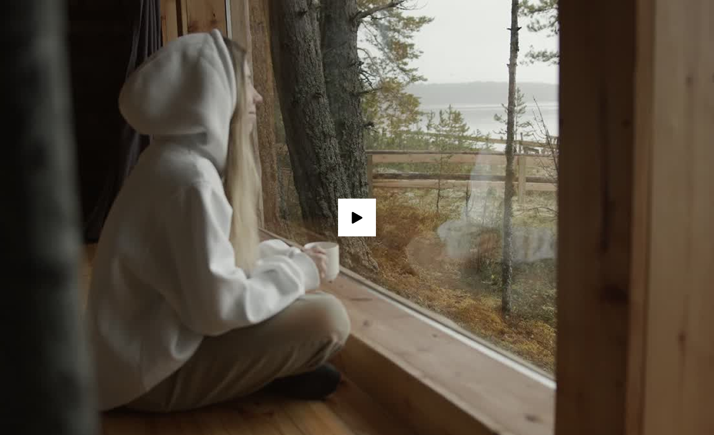

# DWEL® — Contemporary Architecture & Spatial Design



A pixel-perfect implementation of the **Digital Agency / Architecture Studio (DWEL®)** Figma design file (`jLzMxuxzAyQ5NpdT7WFwV1`).

## 🎨 Design Tokens & Specs
- **Font**: [Poppins](https://fonts.google.com/specimen/Poppins) (Weights: 300, 400, 500, 600)
- **Primary Color**: `#DE943D` (Warm Golden Amber)
- **Neutral Darks**: `#111111`, `#333333`
- **Secondary Grays**: `#888888`, `#AAAAAA`
- **Canvas / Background**: `#FFFFFF`, `#F9F9F9`
- **Layout Max Width**: `1320px` (with `60px` side padding)

## 📁 Project Structure
```
4amaliy/
├── images/
│   ├── hero.png            # Main Architecture Showcase Film Banner
│   ├── village_pt.png      # Project: Village Pt (Aspen, Colorado)
│   ├── franklin.png        # Project: Franklin (Miami, Florida)
│   ├── henderson.png       # Project: Henderson (Austin, Texas)
│   ├── hazelwood.png       # Project: Hazelwood (Melbourne, Australia)
│   ├── martin_st.png       # Project: Martin St (Palm Springs, California)
│   ├── concord.png         # Project: Concord (Lake Como, Italy)
│   ├── houston_st.png      # Project: Houston St (Santa Barbara, California)
│   ├── hillsboro.png       # Project: Hillsboro (Portland, Oregon)
│   ├── willow_ave.png      # Project: Willow Ave (Seattle, Washington)
│   └── brentwood.png       # Project: Brentwood (British Columbia, Canada)
├── index.html              # Semantic HTML5 markup
├── style.css               # Clean Vanilla CSS with responsive design system
├── script.js               # Interactive modals, video player, drawer & filters
└── README.md               # Documentation
```

## ✨ Features
1. **Pixel-Perfect Fidelity**: Matches the Figma layout, font hierarchy, colors, and margins.
2. **Interactive Video Showcase**: Center play button opens a video modal with playback controls.
3. **Project Lightbox Details**: Clicking on any project card reveals rich architectural specifications, area, lead architect, materials, and inquiry trigger.
4. **Category Filtering**: Filter projects by Residential, Retreat, Waterfront, or View All.
5. **Slide-Over Info Drawer**: Clicking "INFO" opens a side drawer featuring studio philosophy, values, global studio locations, and press contacts.
6. **Figma Style Guide Modal**: Clicking "Style Guide" in the footer opens the design tokens reference.
7. **Fully Responsive**: Seamless adaptation across Mobile, Tablet, Laptop, and Ultra-wide screens.

## 🚀 How to Run Locally
Open `index.html` directly in any modern browser, or launch a local server:
```bash
# Using Python:
python -m http.server 8000

# Using Node.js npx:
npx serve .
```
Then visit `http://localhost:8000`.
